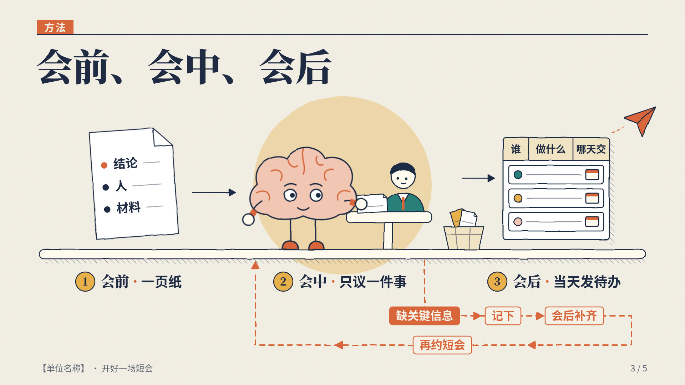
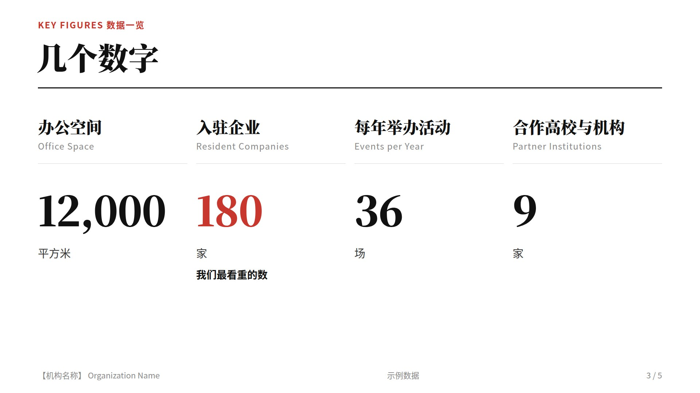

# ppt-studio

让你的 AI 照着两套风格,一页一页画出 PPT:人给讲稿和必要的素材,排版和画面交给它。

| 风格 | 适合 | 样例 |
|---|---|---|
| **讲座版** | 讲座、培训、经验分享 |  |
| **专业版** | 机构简介、项目汇报、申报、成果展示 |  |

样例内容为虚构演示稿;每套 5 页,见 `styles/<风格>/samples/`。

**给 agent**:读本目录 `AGENTS.md`,它会装好、跑自检、缺什么先问你。MIT。
